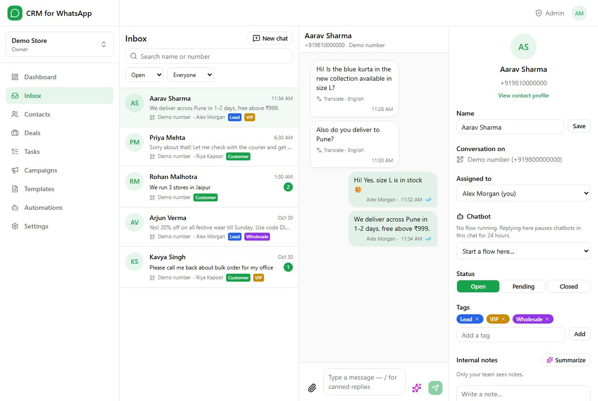
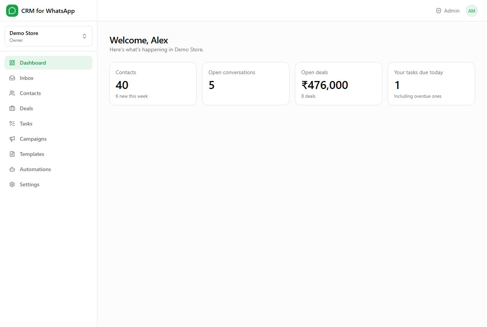
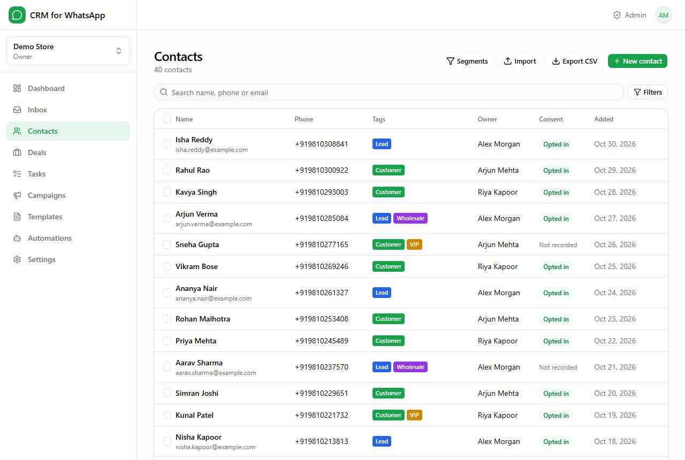
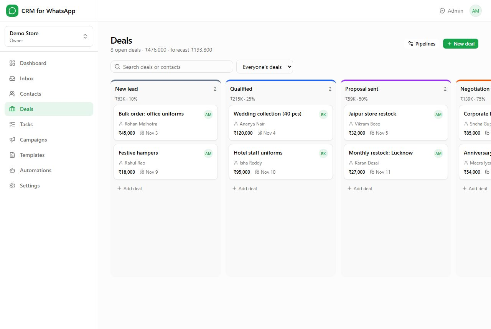
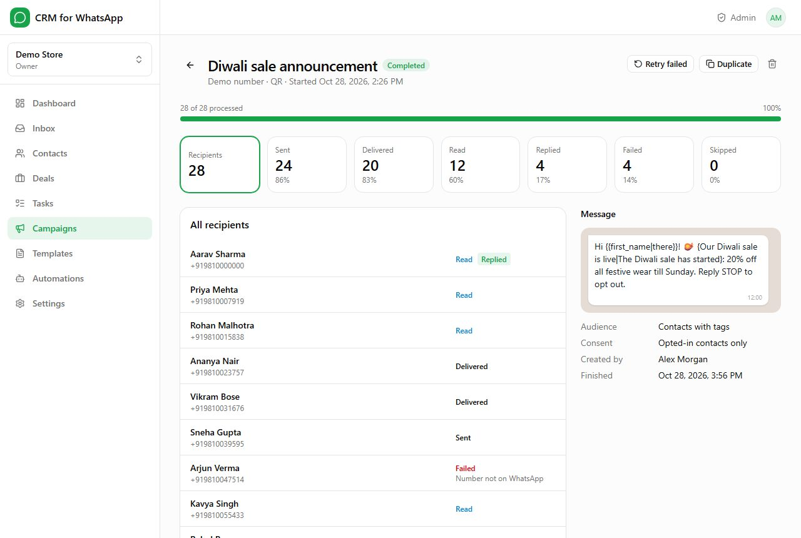
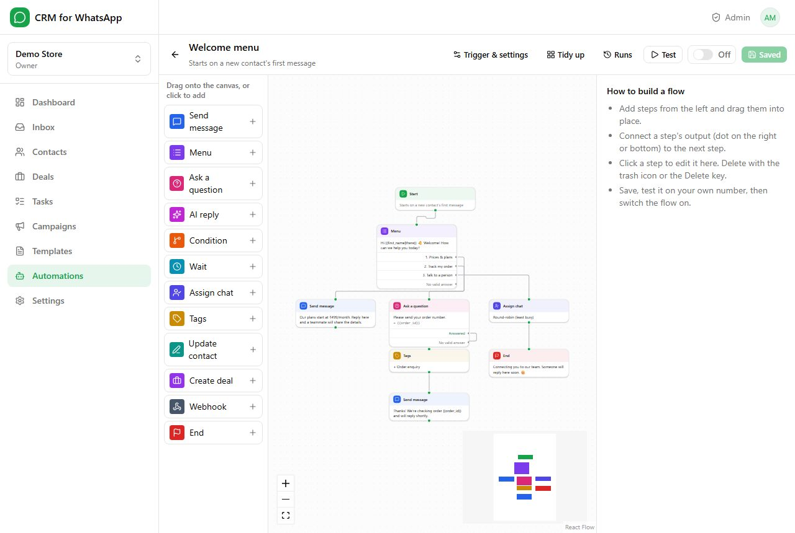
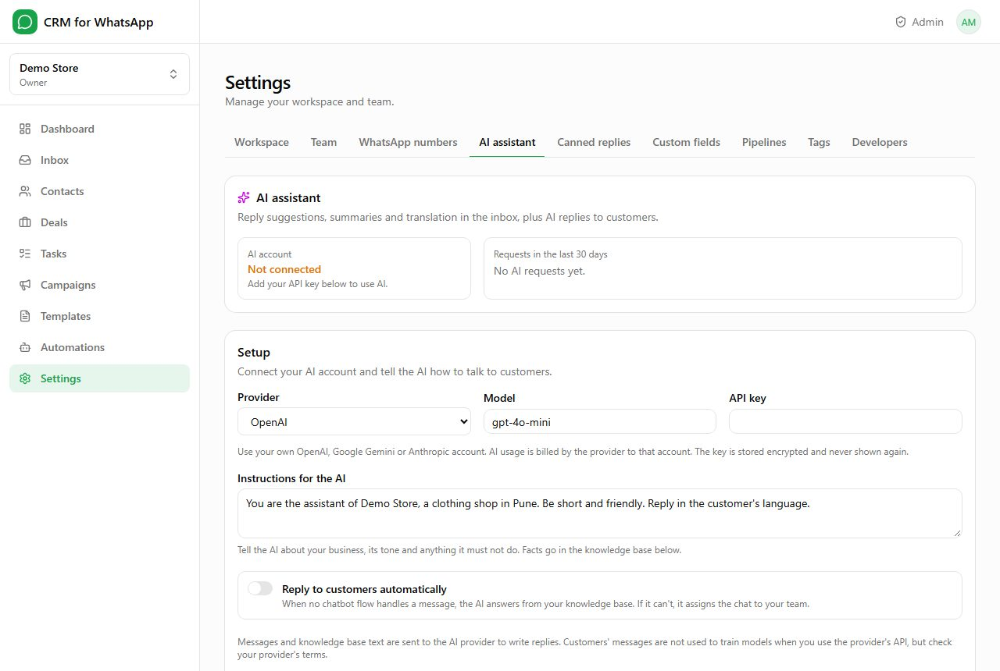

# CRM for WhatsApp

**Open-source, multi-tenant WhatsApp CRM SaaS: shared team inbox, contacts and deals, campaigns,
chatbot flows and an AI assistant** — on the official WhatsApp Cloud API or any WhatsApp number via
QR code (with built-in anti-ban protection), with plans and online payments. Built with Next.js 16,
React 19, Prisma and PostgreSQL.

**Live demo:** https://crm-for-whatsapp-demo.vercel.app — one-click demo logins on the sign-in page
(`admin@demo.test`, `owner@demo.test` or `agent@demo.test`, password `demo1234`; data resets daily).



## Features

- **Two ways to connect WhatsApp**, chosen per number: Meta's official Cloud API, or any WhatsApp
  number by scanning a QR code (with warm-up, pacing and daily limits to lower the ban risk).
- **Real-time team inbox:** assignment, internal notes, tags, quick replies, media, read receipts,
  typing indicators, 24-hour window handling and approved templates.
- **CRM:** contacts with custom fields, CSV import/export, segments, consent tracking, a
  drag-and-drop deals pipeline, tasks with reminders and a contact timeline.
- **Campaigns:** Meta templates (sync, create and submit for approval) or free text with spintax on
  QR numbers, scheduling, throttled sending and live delivery reports.
- **Chatbot flow builder:** menus, questions with validation, conditions, delays, assignment, tags,
  deals, webhooks and AI replies; keyword, first-message and campaign-reply triggers.
- **AI assistant** on each workspace's own OpenAI, Gemini or Claude key: reply suggestions, rewrite,
  translation, chat summaries and auto-replies from a knowledge base.
- **REST API and signed webhooks** for every workspace.
- **SaaS billing:** plans with limits and features, trials, Stripe, Razorpay, PayPal and bank
  transfer, coupons, taxes and invoices.
- **Super-admin panel:** workspaces, plans, payments, "view as owner", branding, email templates
  and SMTP.
- **White label** (app name, logo, colour, favicon), **translation-ready** (right-to-left
  supported) and a **web installer**.

| Dashboard | Contacts | Deals pipeline |
| --- | --- | --- |
|  |  |  |
| **Campaign report** | **Chatbot flow builder** | **AI assistant** |
|  |  |  |

More screenshots are in [`documentation/images`](documentation/images).

## Hosted version & paid installation

Need CRM for WhatsApp hosted for you, installed on your own server, or customised? Contact
**[EpiFive](https://www.epifive.com/services)**.
More open-source projects: https://www.epifive.com/open-source

## Quick start

```bash
git clone https://github.com/epifive/whatsapp-crm.git
cd whatsapp-crm
npm install
npm run dev                   # web app + realtime -> http://localhost:3000 (opens the installer)
npm run dev:worker            # background worker, in a second terminal
```

The web installer (`/install`) checks the server, connects the PostgreSQL database, runs the
migrations and creates the platform admin (optionally with demo data). The full guide (installation,
connecting WhatsApp, billing, updating, FAQ) is in
[`documentation/index.html`](documentation/index.html) (open it in a browser).

## Requirements

- Node.js 20.9+ (22 LTS recommended) and PostgreSQL 14+ — or Docker with Compose
- A domain with HTTPS for production (Meta only sends webhooks to HTTPS)

## Production install

**Docker:**

```bash
cp .env.example .env          # set POSTGRES_PASSWORD, APP_KEY and APP_URL
docker compose up -d --build
```

**VPS (PM2):**

```bash
npm ci
npm run build
pm2 start ecosystem.config.cjs
```

Then open the app in the browser: the **web installer** (`/install`) checks the server, connects the database, runs the migrations and creates the platform admin (optionally with demo data). Nginx: see `deploy/nginx.conf`.

Command-line alternative to the installer:

```bash
cp .env.example .env          # set DATABASE_URL, APP_KEY, APP_URL
npx prisma migrate deploy
npm run create-admin -- --email you@example.com --name "Your Name" --password "a-strong-password"
npm run seed:demo             # optional demo data
```

The app runs as two processes: the web app (`npm start`) and the background **worker** (`npm run worker`) for campaigns, QR connections, chatbot timers, reminders and billing.

## Development

Until SMTP is configured in **Admin › Settings**, outgoing emails are saved as JSON files in `storage/mail-outbox/`.

## Scripts

| Script | Purpose |
| --- | --- |
| `npm run dev` / `npm run dev:worker` | Web app / worker with reload |
| `npm run build` / `npm start` / `npm run worker` | Production build, web app, worker |
| `npm run typecheck` / `npm run lint` | TypeScript (with route types) / ESLint |
| `npm test` | Unit and integration tests (needs `TEST_DATABASE_URL`) |
| `npm run test:e2e` | Browser tests: the main journey and a layout scan of every page at 6 screen widths. Uses its own `*_e2e` database (wiped on each run), a fake Meta API and Google Chrome; run `npm run build` first for speed |
| `npm run create-admin` | Create or promote a platform admin (also closes the web installer) |
| `npm run seed:demo` | Add the demo workspace and example plans |
| `npm run demo:reset` | Public demo server only (`DEMO_MODE=true`): **wipes all data** and creates the demo accounts; the worker repeats it every `DEMO_RESET_HOURS` |

## Project structure

```
server.ts                 Next.js + Socket.IO server (and the installer gate)
src/app/                  Pages and API routes (App Router); /install is the web installer
src/server/               Realtime server, background worker and its jobs
src/lib/                  Auth, tenancy, WhatsApp, campaigns, flows, AI, billing, installer
prisma/                   Database schema, migrations and the demo seeder
messages/                 UI translations (en.json)
documentation/            User and admin guide (HTML)
deploy/                   Nginx example
tests/                    Vitest tests
e2e/                      Playwright end-to-end tests
```

## Translations

UI text lives in `messages/en.json`. To add a language, copy it to `messages/<code>.json`, translate the values and add the code to `LOCALES` in `src/i18n/config.ts` (and to `RTL_LOCALES` for right-to-left languages).

## Contributing

Bug reports and pull requests are welcome — please open an
[issue](https://github.com/epifive/whatsapp-crm/issues) first for larger changes. Run
`npm run lint`, `npm run typecheck` and `npm test` before sending a PR.

## License

[MIT](LICENSE) © 2026 EpiFive
